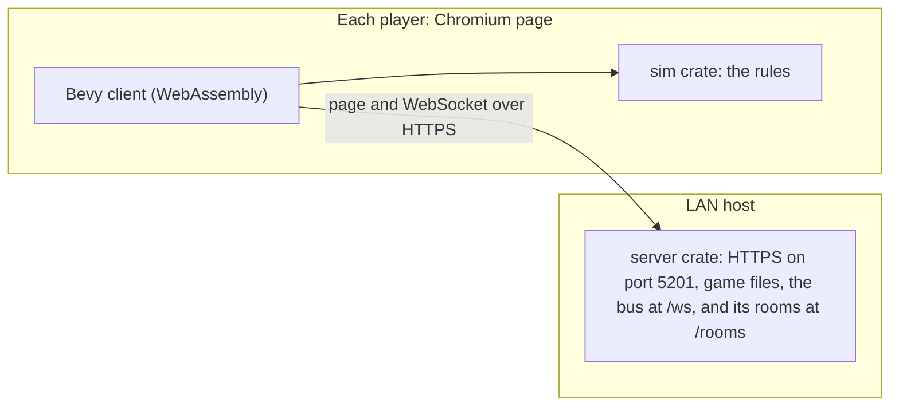

# Concept, architecture, and design plan

This document is the plan for the game. `README.md` gives the overview, and `requirements.md` lists what the game must do. It rests on the measurements and the research in `feasibility.md`, which holds the evidence for each claim here. It was written on 2026-11-20, after the prototype of step 1 played whole matches in automatic tests.

## Concept

**One sentence.** You are a fighter pilot in a small, loud dogfight over a LAN, and each hit you take changes how your plane flies.

**The feeling.** A tense chase that turns into a fight for control: a wing breaks off, the plane pulls to one side, and you choose to fight on or run.

**The verbs.**

- Fly: turn, pitch, throttle, and boost.
- Shoot: one forward gun, with tracers.
- Survive: fly a damaged plane home, or turn it into one last attack.

**The core loop.** Find a target, get behind it, shoot it apart, and lose it before its friends find you. A round lasts a few minutes, and a respawn takes three seconds.

**What impresses the judges.**

- Netcode that a player can feel: no input delay, the same result on every machine, and a whole match that can replay from its message log.
- Damage that changes the flight. The player sees and feels each lost part.
- Up to 16 players on one LAN, with bots that fill empty places, in a browser with nothing to install.
- One visible GPU simulation, such as clouds or smoke, as a stretch goal.

**Modes.**

- Solo: one player against four bots (PvE).
- Online: every player on the LAN in one sky, with bots that keep the sky busy (PvP and PvE).

## Architecture

The arrows show who connects to whom. Every message travels through the bus.

**The parts.**

| Part | Language | Job |
|---|---|---|
| `crates/sim` | Rust, no engine | The rules: flight, damage, guns, hits, bots, and the message format. Every machine runs it. |
| `crates/client` | Rust, Bevy 0.20, WebAssembly | Input, the camera, the screens, and the drawing. It calls `sim` and talks to the bus. |
| `crates/server` | Rust, `hyper`, `rustls`, `tokio-tungstenite` | Serves `web/` over HTTPS with a self-signed certificate, which it keeps in `.server/` until the addresses of the machine change. Its bus at `/ws` holds rooms. A room sends each message to every member in one order, and the bus knows nothing about the game. |
| `crates/xtask` | Rust | `cargo xtask build` builds the client into `web/app.js` and `web/app_bg.wasm`. |
| `web/` | HTML | The page that loads the client. |
| `tests/browser` | TypeScript, Playwright | Plays whole matches in headless Chromium. |

**The rules of the architecture.**

- Each fact of the game lives in `sim`. The client only gathers input, calls `sim`, sends and receives messages, and draws.
- `sim` has no engine and no screen, so its tests play whole fights in milliseconds.
- Each player owns its plane, and decides its movement and its hits. The owner of the target applies damage. Thus the shooter sees a hit at once, and each plane has one owner.
- The bus gives all messages one order. Every machine applies shared events in that order, so all machines agree.
- The owner of the room, which the bus names, hosts its lobby: it chooses the bots, starts and ends matches, renames the room, and removes players. When it leaves, the bus names the next one.
- The lowest player number in an online match flies the bots. When that player leaves, the next one takes them.
- The game sends through two calls: a state and an event. The transport can change behind them.

**The messages.** `sim::wire` defines eight: `State`, `Hit`, `Kill`, `Launch`, `Burst`, and `EndMatch` for the match, and `Lobby` and `Profile`, which carries the name of a player, for the lobby. `sim::room` reads the text frames of the bus: the status of the room, the room list, the control requests, and the close codes. A state is about 40 bytes, 30 times a second for each plane. The shooter flies its own missiles and decides their hits, and the other machines draw them from `Launch` and `Burst`. Sixteen planes send about 20 kB a second in total, far below what a LAN carries.

**Rooms.** The bus holds rooms, so that several games run on one LAN at once. A room is one ordered channel among its members, with the number of the sender in front of each binary message, as before. Player numbers are unique on the whole server. The server keeps the members of each room in join order, and the owner is the member with the lowest number. The game logic stays in the client: the server never reads a binary message.

- `GET /ws` joins the open room, "Open room", which always exists. `GET /ws?room=<id>` joins a room, and `GET /ws?create=<title>` makes a room and joins it. The title is percent-decoded, trimmed, and cut to 32 characters, and an empty title becomes "Room <id>". The ids are decimal numbers that count up, and the open room is `0`.
- A room holds at most 16 members, and the server holds at most 64 rooms. A refused join gets a close frame: 4001 "no such room", 4002 "room is full", or 4003 "too many rooms". The server drops a message larger than 4 KiB, and removes a room when its last member leaves, apart from the open room.
- The server sends each member a text frame `room:{"id":"3","title":"…","owner":12,"members":[12,15,16],"you":15}` when it joins, and again when the members, the owner, or the title change. The status takes its place in the order of the room.
- Text frames from the owner control the room, and the server never relays them: `info:<text>` sets the info of the room (120 characters at most), `title:<text>` renames it, and `kick:<number>` closes the socket of that member with code 4000 "removed by the host". The server ignores other text, and text from other members.
- `GET /rooms` lists the rooms in the order of creation, with `Cache-Control: no-store`: `[{"id":"0","title":"Open room","members":3,"owner":12,"info":"…"}]`. The owner of an empty room is `null`.

**Purity.** All code is Rust, apart from the one line of the page that starts the client, and the browser tests in TypeScript. Nothing compiles C, and the host links with the linker of the Rust toolchain. The server encrypts with `rustls` and a pure-Rust provider.

## Design plan

The plan follows the game-design method: prove the loop with grey boxes, then add one system at a time, and playtest after each step.

### Step 1: the playable prototype (built)

- Flight by mouse: the plane turns toward the cursor. The keyboard is a full alternative, and every key can change in the settings. Third-person camera.
- Guns with tracers, and missiles that need a lock of 1.2 s and can be escaped by an early, hard break.
- Five breakable parts on each plane, death and respawn, and 5 s of spawn protection.
- Solo against bots, and online over the bus with bots that the first player flies. A lobby before each mode chooses from 0 to 8 bots and their skill: Rookie, Pilot, Veteran, or Ace. Online, each player names itself, and the room list shows the rooms with their players and what they do. A player creates a room or joins one. The owner of the room hosts its lobby: it chooses the bots, renames the room, removes players, starts the match, and ends it from the pause menu, after which every player sees the results. A player that comes later joins the running match.
- The question for the playtest: is it fun to chase and shoot a plane apart? If not, change the flight and the gun numbers in `sim::tuning` first. Do not add content.

**How to play it.**

1. Run `cargo xtask serve` (or `mise run serve`, which runs the same). It builds both clients, starts the server, and prints the addresses. Stop it with Ctrl+C, and run it again after each change of the code.
2. Open `https://<address of the host>:5201` in a current Chromium browser, on this machine or on the LAN. Accept the certificate warning once.
3. Enter a name at the first visit. Choose "Solo" to fight the bots, or "Online" on several machines to fight each other: create a room, or join one from the list. Choose the bots in the lobby, and press "Start" or "Start match".

**Default controls.** All keys can change in "Settings".

| Action | Input |
|---|---|
| Steer | Point with the mouse. The plane turns toward the cursor, and a cursor at the centre flies straight. No key steers. |
| Guns | Left mouse button, or Space |
| Missile | Right mouse button, or F. The lock box must close on the target first. |
| Flare | E |
| Throttle | Mouse wheel, or W and S |
| Boost | Left Shift |
| Pause menu, which also pauses a solo match | Escape |

**Phone controls.** A phone gets the touch layout: hold it sideways. The stick under the left thumb steers, and the tilt of the phone steers too, from the pose in which the match starts. "TILT" turns the tilt off and on, and "CENTRE" takes the current pose as straight ahead. Thumb buttons: GUN (hold), MSL, FLARE, and BOOST (hold), and the THR slider sets the throttle; "II" pauses. Safari on iOS asks for the sensor at the first tap. A tap on "Start Match" enters full screen and holds the screen sideways where the browser allows it.

**What to watch in the playtest.**

- Does the mouse feel direct? The sensitivity and the inversion are in the settings, and the steering gain is in `sim::steer_toward`.
- Can a player see a missile coming, and escape it? If not, lengthen the lock time or change the seeker in `sim::tuning`.
- Can a new player find a target and hit it? If not, slow the planes or enlarge the hit spheres in `sim`.
- Does a lost part change the next decision of the player? If the player only notices the bar, make the effect stronger.

**Test hooks.** The address takes `auto=solo` or `auto=online` to skip the menu and the lobby, `bots=N` and `skill=rookie|pilot|veteran|ace` to set the bots of the lobby, `pilot=bot` to let a bot fly, `seconds=N` to end a test run, `stat=1` to log the numbers of a match without the automatic mode, `screen=settings`, `screen=rooms`, or `screen=lobby` to open that screen, `name=<text>` to set the name without the prompt, `room=<id>` to join a room and `create=<title>` to create one (`auto=online` without either joins the open room), `touch=1` to force the phone layout on a desktop, and `pixels=N` to change the limit of device pixels for each CSS pixel on a phone (1.5 by default). `tests/browser/play.ts` uses them to play whole matches in a headless browser.

### Step 2: feel

Add these only after a playtest says the loop works.

- A hit flash on the target, a short pause of the camera on a kill, and smoke from a damaged part.
- Sound: engine, gun, hits, and a break. Check the audio defect of Bevy on the web first (`feasibility.md`).
- Forgiving aim: a hit sphere slightly larger than the part already helps. A lead marker on the target is the next aid.

### Step 3: the netcode showcase

- Record the message stream on the bus, and replay a kill from the view of the victim.
- Spectator view: a page that reads the stream and owns no plane.
- An on-screen graph of the delay of each remote plane, as a debug view for the judges. The adaptive interpolation delay is built (`feasibility.md`, "Remote planes over an uneven network").

### Step 4: one GPU simulation

- Clouds or smoke as a compute shader. The measured budget allows a field of several million cells. Planes that fly through a cloud leave a hole in it, so the simulation answers the player.

### Step 5: stretch goals

- A battle royale rule set: a ring that closes, and the last plane flying wins.
- Phones (note 19): built, and not yet tested on a real phone. See "Phone controls" in step 1. `feasibility.md` has the facts.
- Relativity as a mode: a lower speed of light, with the vertex warp that the probe measured.
- Generated models and sound through the asset services, once a person accepts a sample.

### Cut list

These ideas stay out, with the reason. Each needs a reason to come back.

- WebGL2 as a fallback: the owner decided on 2026-11-21 that the game needs WebGPU, and the demo runs on Chromium.
- Camera input (head pose for the view): the isolation design works, but no person owns the shell page, and the owner ruled camera input out on 2026-11-21.
- iroh, WebTransport, and WebRTC: the bus covers a LAN, and the transport can change behind two calls if playtests show hitches on Wi-Fi.
- An authoritative server: it stops cheats, which do not matter at a jam.
- Soft bodies, large destruction, and a physics engine: planes need a few parts and their own flight model.
- A soulslike: its cost is animation content.
- Eye tracking for aim: webcam gaze is too coarse.

## Time and compute

Contest time is short, so the loop of edit, build, and test must be fast.

- Test the rules in `sim` first, with `mise run test`. A clean build and the full test run take about 4 s.
- `mise run build` builds the client in 14 to 20 s after a change. The release build is for playtests and the demo.
- One headless browser test of 40 s checks a whole match, with numbers in the log and a screenshot.
- The measured times are in `feasibility.md`, under "Compute times".
- Run one GPU job at a time. A long job on the integrated GPU makes the desktop slow.

## Risks

| Risk | Sign | Answer |
|---|---|---|
| The flight is not fun | Players fly in circles and do not chase | Change `sim::tuning`, and playtest again |
| Hitches on Wi-Fi | Remote planes jump | The demo is hosted locally, so Wi-Fi does not apply there. If machines join over Wi-Fi, wire the host, then try the steps in `feasibility.md` |
| WebGPU missing on a demo machine | The page says so at start | Bring a laptop with a current Chromium |
| Too few players at the demo | Empty sky | Bots fill the sky in both modes |
| The certificate warning confuses judges | Judges stop at the warning page | Open each demo browser on the game once before the judges come |
